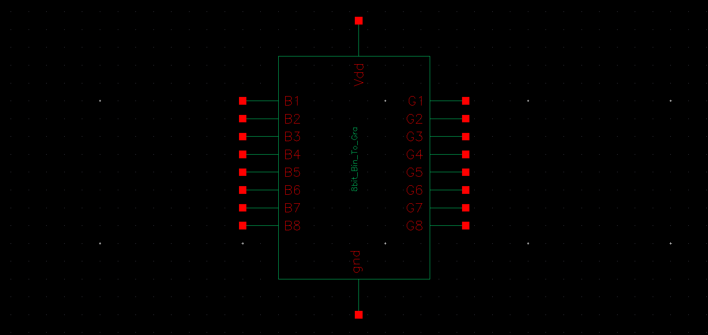
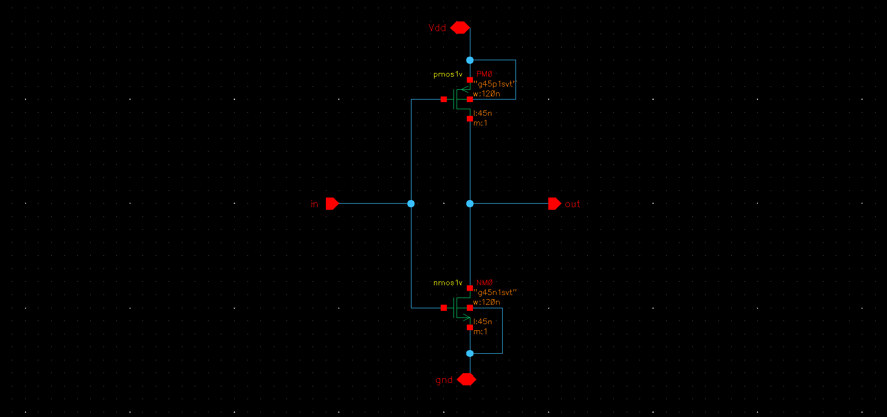

# 8-bit Binary-to-Gray Code Converter


An 8-bit combinational Binary-to-Gray Code Converter designed and simulated using **Cadence Virtuoso**.

## Table of Contents

1. [Project Overview](#project-overview)
2. [Design Objective](#design-objective)
3. [Conversion Theory and Equations](#conversion-theory-and-equations)
4. [Example Truth Table](#example-truth-table)
5. [Design Screenshots](#design-screenshots)
6. [Simulation Results](#simulation-results)
7. [Repository Structure](#repository-structure)
8. [Opening the Cadence Project](#opening-the-cadence-project)
9. [Tools and Technology](#tools-and-technology)
10. [Author](#author)

## Project Overview

This project converts an 8-bit binary input, `B[7:0]`, into its equivalent 8-bit Gray-code output, `G[7:0]`. In Gray code, two consecutive code words differ by only one bit.

## Design Objective

- Accept an 8-bit binary input.
- Generate the corresponding 8-bit Gray-code output.
- Implement the conversion using CMOS digital logic.
- Design and simulate the circuit in Cadence Virtuoso.
- Preserve the project archive, design screenshots and simulation graph outputs.

## Conversion Theory and Equations

The most significant Gray-code bit is the same as the most significant binary bit. Each remaining Gray-code bit is the XOR of two adjacent binary bits.

```text
G7 = B7
G6 = B7 XOR B6
G5 = B6 XOR B5
G4 = B5 XOR B4
G3 = B4 XOR B3
G2 = B3 XOR B2
G1 = B2 XOR B1
G0 = B1 XOR B0
```

Compact expression: `G = B XOR (B >> 1)`.

## Example Truth Table

| Decimal | Binary input B[7:0] | Gray output G[7:0] |
|---:|:---:|:---:|
| 0 | `00000000` | `00000000` |
| 1 | `00000001` | `00000001` |
| 2 | `00000010` | `00000011` |
| 3 | `00000011` | `00000010` |
| 4 | `00000100` | `00000110` |
| 5 | `00000101` | `00000111` |
| 6 | `00000110` | `00000101` |
| 7 | `00000111` | `00000100` |
| 15 | `00001111` | `00001000` |

## Design Screenshots

Each screenshot below has a descriptive title to identify the Cadence design view or implementation stage.

### 8-bit Binary-to-Gray Converter

**1. Top-Level 8-bit Binary-to-Gray Converter Schematic**  


**2. 8-bit Converter Testbench Setup**  


**3. 8-bit Converter Layout**  


**4. 8-bit Converter Symbol View**  


**5. 8-bit Converter Physical Layout View**  
.png)

**6. 8-bit Binary-to-Gray Simulation Waveforms**  
.png)

### XOR Gate Design

**7. XOR Gate Transistor-Level Schematic**  


**8. XOR Gate Symbol View**  


**9. XOR Gate Layout**  


**10. XOR Gate CMOS Implementation**  
.png)

**11. 8-bit XOR Block Symbol View**  
.png)

### CMOS Inverter Design

**12. CMOS Inverter Transistor-Level Schematic**  


**13. CMOS Inverter Symbol View**  


**14. CMOS Inverter Layout**  


### CMOS Buffer Design

**15. CMOS Buffer Transistor-Level Schematic**  


**16. CMOS Buffer Symbol View**  


**17. CMOS Buffer Layout**  


**18. CMOS Buffer Additional Design View**  
.png)

## Simulation Results

The simulation graph PDFs are available here:

- [Simulation graph PDF 1](results/graph8bitbintograyprint.pdf)
- [Simulation graph PDF 2](results/graph8bitbintograyprintprint.pdf)

The PDFs are retained as supplied. Refer to the actual Cadence setup and graph files when interpreting waveforms or performance.

## Repository Structure

```text
8bit-Binary-to-Gray-Code-Converter/
├── README.md
├── .gitignore
├── 8bit_conn_sche.png
├── 8bit_lay.png
├── 8bit_sym.png
├── 8bit_tb.png
├── 8bitlayout (1).png
├── 8bitsimu (1).png
├── CMOS_INV__Schematic.png
├── CMOS_INV__symbol.png
├── CMOS_INV_Lay.png
├── cmos_buff_sche.png
├── cmos_buff_sym.png
├── cmos_buff_lay.png
├── cmosbuffer (1).png
├── xor_schematicVJ.png
├── xor_symbol.png
├── xor_Lay.png
├── xorcmos (1).png
├── xorsym8bit (1).png
├── project/
│   └── Bin_To_G.zip
└── results/
    ├── graph8bitbintograyprint.pdf
    └── graph8bitbintograyprintprint.pdf
```

## Opening the Cadence Project

1. Download `project/Bin_To_G.zip`.
2. Extract it in a working directory accessible to Cadence Virtuoso.
3. Review the included library definition and project structure.
4. Open the library using Cadence Library Manager.
5. Ensure the required technology library/PDK is available in your environment.
6. Open the relevant schematic and testbench, then run the simulation using the included configuration.

Cadence version, PDK setup and library paths can vary between lab environments. Use the archive as the source of truth for the exact cell names and setup.

## Tools and Technology

| Item | Details |
|---|---|
| EDA tool | Cadence Virtuoso |
| Design domain | Digital VLSI / CMOS logic |
| Function | 8-bit Binary-to-Gray conversion |
| Technology node | 45 nm  |
| Project files | Cadence project ZIP archive |
| Results | Simulation graph PDFs and design screenshots |

## Author

**SSS Vijay Kumar**  
M.Tech — VLSI & Microelectronics
226ec1009
---

## Important Notes

- This is an academic design project; consult the uploaded archive for exact implementation details.
- Before making the repository public, check the archive for licensed PDK data, proprietary technology files, passwords, machine-specific paths or institute/company-confidential material.
- Do not redistribute foundry or EDA tool files unless their licence permits it.
