# 8-bit Binary-to-Gray Code Converter


A beginner-friendly documentation of an **8-bit Binary-to-Gray Code Converter** designed and simulated using **Cadence Virtuoso**.

## Student Details

- **Name:** SSS Vijay Kumar
- **Programme:** M.Tech (VLSI & Microelectronics)
- **Roll Number:** 226EC1009

## Table of Contents

1. [Introduction](#1-introduction)
2. [What Is Binary Code?](#2-what-is-binary-code)
3. [What Is Gray Code?](#3-what-is-gray-code)
4. [Project Objective](#4-project-objective)
5. [How the Converter Works](#5-how-the-converter-works)
6. [Logic Equations](#6-logic-equations)
7. [Worked Examples and Truth Table](#7-worked-examples-and-truth-table)
8. [Circuit Architecture](#8-circuit-architecture)
9. [Design Screenshots](#9-design-screenshots)
10. [Understanding the Simulation Graphs](#10-understanding-the-simulation-graphs)
11. [Applications](#11-applications)
12. [Project Files and Repository Structure](#12-project-files-and-repository-structure)
13. [How to Open the Cadence Project](#13-how-to-open-the-cadence-project)
14. [Tools and Technology](#14-tools-and-technology)
15. [Conclusion](#15-conclusion)

---

## 1. Introduction

Digital systems represent information using binary digits: **0** and **1**. A binary number can change several bits when its value increases by one. For example:

- Binary 3 = `0011`
- Binary 4 = `0100`

Three bits change between these two values. In some digital systems, changing several bits at nearly the same time can cause temporary errors or ambiguous transitions.

**Gray code** is a special binary coding system in which two consecutive values differ in only one bit. This project converts an 8-bit binary number into its equivalent 8-bit Gray-code number.

## 2. What Is Binary Code?

Binary is a base-2 number system. It uses only two symbols:

- `0` represents a LOW logic state.
- `1` represents a HIGH logic state.

An 8-bit binary number contains eight bits, from `B7` (most significant bit, MSB) to `B0` (least significant bit, LSB).

Example:

```text
Binary input:  00000101
Decimal value: 5
```

Each bit has a place value that is a power of two.

## 3. What Is Gray Code?

Gray code, also called reflected binary code, is a numbering system in which adjacent code words differ in exactly one bit.

Example:

| Decimal | 4-bit Binary | 4-bit Gray |
|---:|:---:|:---:|
| 0 | 0000 | 0000 |
| 1 | 0001 | 0001 |
| 2 | 0010 | 0011 |
| 3 | 0011 | 0010 |
| 4 | 0100 | 0110 |
| 5 | 0101 | 0111 |
| 6 | 0110 | 0101 |
| 7 | 0111 | 0100 |

Notice that consecutive Gray-code values change by only one bit. This property helps reduce transition ambiguity in systems such as rotary encoders.

## 4. Project Objective

The objective is to design an 8-bit combinational circuit that:

1. Takes an 8-bit binary input, `B[7:0]`.
2. Converts it into an equivalent Gray-code output, `G[7:0]`.
3. Uses CMOS logic blocks to implement the required logic.
4. Is designed and simulated in Cadence Virtuoso.
5. Provides schematic, symbol, layout and transient simulation views for inspection.

The converter is **combinational**: its output depends on the current input. It does not require a clock or store previous input values.

## 5. How the Converter Works

The conversion follows two simple rules:

1. The most significant Gray bit is copied directly from the most significant binary bit.
2. Every other Gray bit is obtained by XORing two neighbouring binary bits.

An XOR gate produces:

| A | B | A XOR B |
|:---:|:---:|:---:|
| 0 | 0 | 0 |
| 0 | 1 | 1 |
| 1 | 0 | 1 |
| 1 | 1 | 0 |

In simple words, XOR gives **1 when its two inputs are different**, and gives **0 when they are the same**.

### Block-level operation

```text
       8-bit Binary Input
          B[7:0]
             |
             v
   +-----------------------+
   | Binary-to-Gray Logic  |
   |                       |
   | G7 = B7               |
   | G6 = B7 XOR B6        |
   | G5 = B6 XOR B5        |
   |       ...             |
   | G1 = B2 XOR B1        |
   | G0 = B1 XOR B0        |
   +-----------------------+
             |
             v
       8-bit Gray Output
          G[7:0]
```

There are seven XOR operations and one direct connection for the MSB.

## 6. Logic Equations

For an 8-bit binary input `B7 B6 B5 B4 B3 B2 B1 B0`, the Gray-code output is:

```text
G7 = B7
G6 = B7 XOR B6
G5 = B6 XOR B5
G4 = B5 XOR B4
G3 = B4 XOR B3
G2 = B3 XOR B2
G1 = B2 XOR B1
G0 = B1 XOR B0
```

The compact expression is:

```text
G = B XOR (B >> 1)
```

Here, `B >> 1` means shifting the binary number one position to the right. The XOR operation is then performed bit by bit.

## 7. Worked Examples and Truth Table

### Example 1: Convert binary 5 into Gray code

Step 1: Write the 8-bit binary number.

```text
B = 00000101
```

Step 2: Copy the most significant bit.

```text
G7 = B7 = 0
```

Step 3: XOR each adjacent pair.

```text
G6 = 0 XOR 0 = 0
G5 = 0 XOR 0 = 0
G4 = 0 XOR 0 = 0
G3 = 0 XOR 0 = 0
G2 = 0 XOR 1 = 1
G1 = 1 XOR 0 = 1
G0 = 0 XOR 1 = 1
```

Therefore:

```text
Binary input = 00000101
Gray output  = 00000111
```

### Example 2: Convert binary 3 into Gray code

```text
Binary = 00000011
Gray   = 00000010
```

### Sample conversion table

| Decimal | Binary input B[7:0] | Gray output G[7:0] |
|---:|:---:|:---:|
| 0 | `00000000` | `00000000` |
| 1 | `00000001` | `00000001` |
| 2 | `00000010` | `00000011` |
| 3 | `00000011` | `00000010` |
| 4 | `00000100` | `00000110` |
| 5 | `00000101` | `00000111` |
| 6 | `00000110` | `00000101` |
| 7 | `00000111` | `00000100` |
| 15 | `00001111` | `00001000` |

An 8-bit converter supports 256 possible input combinations, from decimal 0 to 255. The table above shows selected examples, not all 256 combinations.

## 8. Circuit Architecture

The circuit is built from logic blocks:

- **XOR gate:** performs the bitwise exclusive-OR operation needed for seven Gray output bits.
- **Direct connection:** connects binary MSB `B7` to Gray MSB `G7`.
- **CMOS inverter and buffer cells:** supporting CMOS cells are included among the uploaded design views. Their exact role in the final top-level implementation should be confirmed from the Cadence schematic hierarchy.

### Why CMOS?

CMOS means Complementary Metal-Oxide-Semiconductor. It uses complementary PMOS and NMOS transistors to implement digital logic. CMOS is widely used because it offers low static power consumption and good integration density.

### What are schematic, symbol and layout?

- **Schematic:** a circuit diagram showing components and their electrical connections.
- **Symbol:** a compact graphical representation of a circuit block, used when connecting it to a larger design.
- **Layout:** the physical geometrical representation of the circuit, including shapes and layers used in chip fabrication.
- **Testbench:** a simulation setup that applies input patterns and observes the circuit outputs.

## 9. Design Screenshots

The screenshots below are the design images uploaded to this repository. Captions identify the view shown.

### 8-bit Binary-to-Gray Converter

**1. Top-Level 8-bit Binary-to-Gray Converter Schematic**  
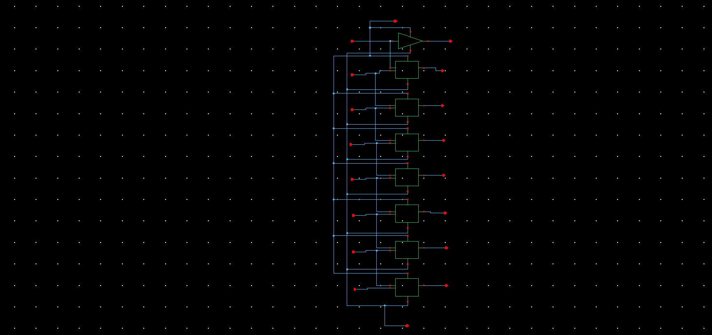

**2. 8-bit Converter Testbench Setup**  
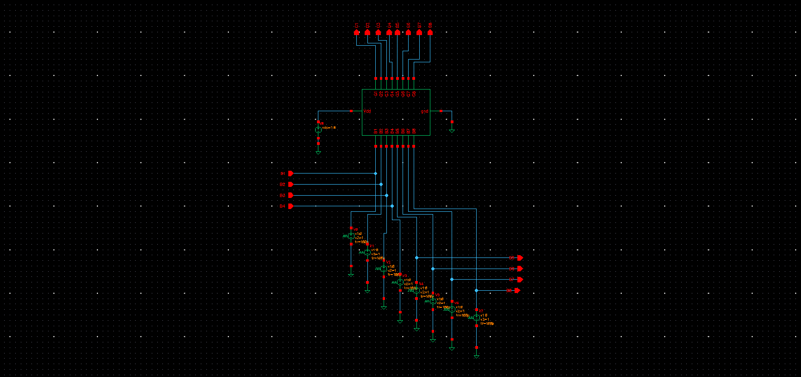

**3. 8-bit Converter Layout**  
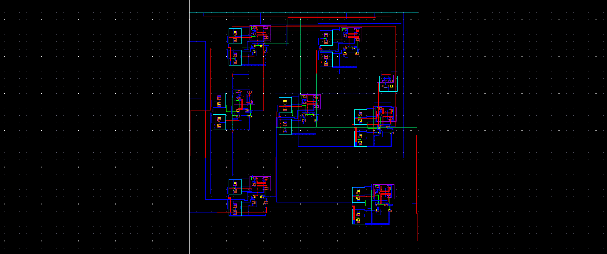

**4. 8-bit Converter Symbol View**  


**5. 8-bit Converter Physical Layout View**  
.png)

**6. 8-bit Binary-to-Gray Simulation Waveforms**  
.png)

### XOR Gate Design

**7. XOR Gate Transistor-Level Schematic**  
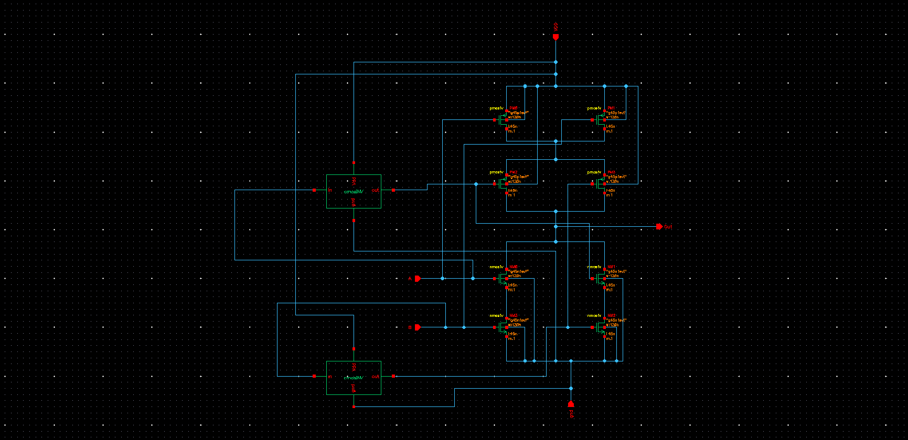

**8. XOR Gate Symbol View**  
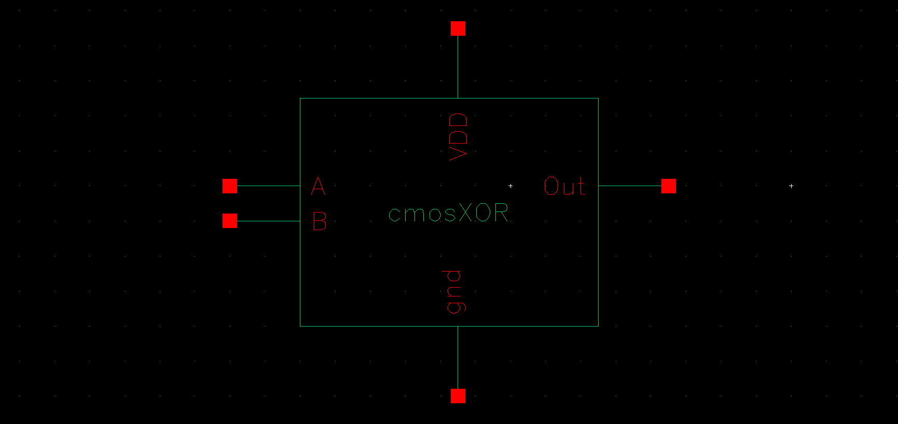

**9. XOR Gate Layout**  
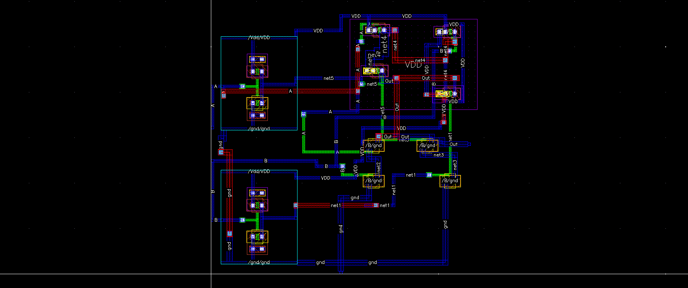

**10. XOR Gate CMOS Implementation**  
.png)

**11. 8-bit XOR Block Symbol View**  
.png)

### CMOS Inverter Design

**12. CMOS Inverter Transistor-Level Schematic**  


**13. CMOS Inverter Symbol View**  
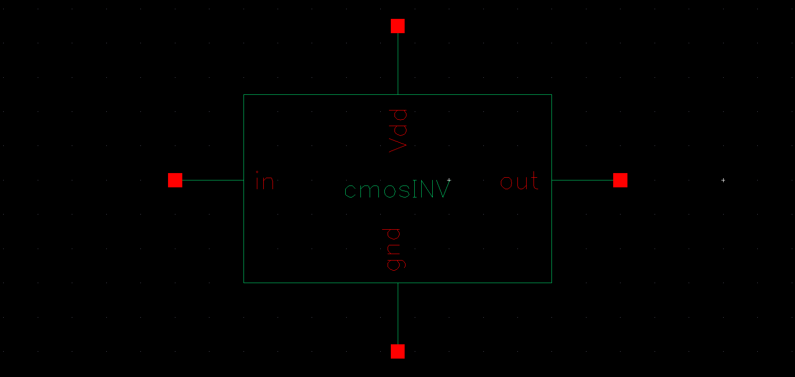

**14. CMOS Inverter Layout**  
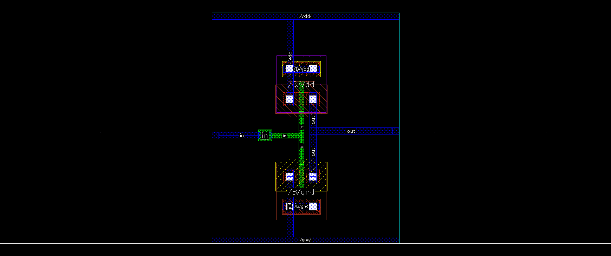

### CMOS Buffer Design

**15. CMOS Buffer Transistor-Level Schematic**  
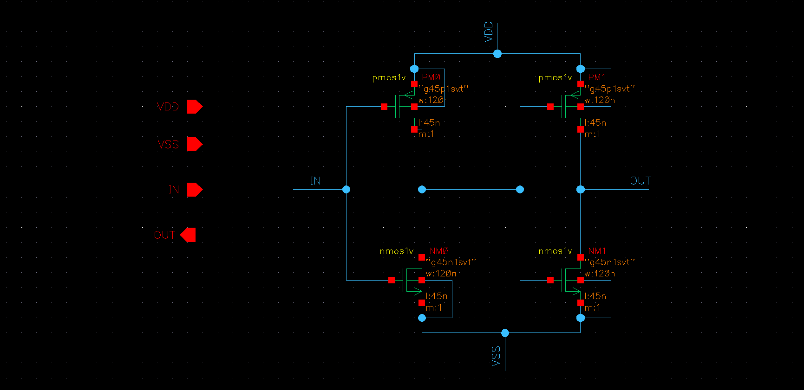

**16. CMOS Buffer Symbol View**  
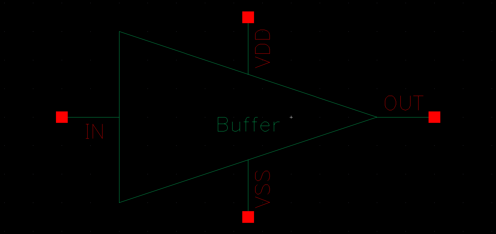

**17. CMOS Buffer Layout**  
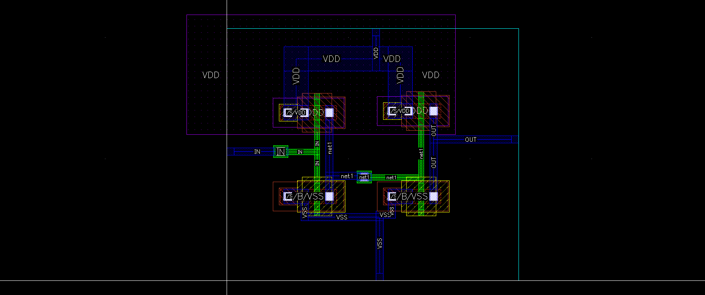

**18. CMOS Buffer Additional Design View**  
.png)

## 10. Understanding the Simulation Graphs

The repository contains two transient-response graph PDFs:

- [Open simulation graph 1](results/graph8bitbintograyprint.pdf)
- [Open simulation graph 2](results/graph8bitbintograyprintprint.pdf)

### What does transient response mean?

Transient analysis shows how circuit voltages change over time after input signals are applied. The horizontal axis in these graphs is time in microseconds (`us`), and each waveform represents a named input or output signal.

### Graph 1

The first graph displays the binary input signals `B8` through `B1` and the first group of Gray outputs, `G8` through `G5`.

### Graph 2

The second graph displays the lower binary input signals `B4` through `B1` and Gray outputs `G8` through `G1`.

### How to verify the waveforms

For each stable input combination, check that:

- `G8` equals `B8`.
- `G7` equals `B8 XOR B7`.
- `G6` equals `B7 XOR B6`.
- Continue the same adjacent-bit XOR rule down to `G1 = B2 XOR B1`.

The two PDFs show transient waveforms, but the plotted traces alone do not establish a complete pass for all 256 input combinations. Also check the actual supply voltage, output logic levels, signal names and settled values in the Cadence testbench. Brief transition glitches can occur because real gates have propagation delay.

## 11. Applications

Gray code is useful in digital systems where it is helpful to minimise the number of bits changing between adjacent states.

Examples include:

- **Rotary encoders:** helps reduce ambiguity when reading the position of a rotating shaft.
- **Position sensing:** supports digital position measurement systems.
- **Analog-to-digital conversion:** Gray coding is used in some converter architectures.
- **Digital communication and logic systems:** can be useful where single-bit transitions are desirable.

## 12. Project Files and Repository Structure

```text
8bit-Binary-to-Gray-Code-Converter/
├── README.md
├── .gitignore
├── design screenshots (.png)
├── project/
│   └── Bin_To_G.zip
└── results/
    ├── graph8bitbintograyprint.pdf
    └── graph8bitbintograyprintprint.pdf
```

- **PNG files:** screenshots of the schematics, symbols, layouts and simulation views.
- **ZIP archive:** the Cadence project files supplied for this project.
- **PDF files:** transient simulation graph exports.

## 13. How to Open the Cadence Project

1. Download [the Cadence project archive](project/Bin_To_G.zip).
2. Extract it into a working directory accessible to Cadence Virtuoso.
3. Review the included library definition and project structure.
4. Open the library using Cadence Library Manager.
5. Ensure the required technology library/PDK is available in your environment.
6. Open the relevant schematic and testbench, then run the simulation using the included configuration.

Cadence version, PDK setup and library paths can vary between lab environments. Use the archive as the source of truth for exact cell names and setup.

## 14. Tools and Technology

| Item | Details |
|---|---|
| EDA tool | Cadence Virtuoso |
| Design domain | Digital VLSI / CMOS logic |
| Function | 8-bit Binary-to-Gray conversion |
| Technology node | 45 nm (as recorded for this project) |
| Logic operation | XOR and direct MSB connection |
| Project files | Cadence project ZIP archive |
| Result material | Transient graph PDFs and design screenshots |

## 15. Conclusion

This project demonstrates the design of an 8-bit combinational Binary-to-Gray Code Converter using CMOS digital logic. It introduces the relationship between binary and Gray code, demonstrates how XOR gates perform the conversion, and documents the schematic, symbol, layout and transient simulation views created in Cadence Virtuoso.

The key concept is simple: **copy the most significant binary bit, then XOR every pair of adjacent binary bits to generate the remaining Gray-code bits.**

---

## Important Notes

- This is an academic design project. Refer to the uploaded Cadence archive for exact implementation details.
- The conversion equations and examples in this README describe the standard 8-bit Binary-to-Gray conversion.
- Before making the repository public, check the archive for licensed PDK data, proprietary technology files, passwords, machine-specific paths or institute/company-confidential material.
- Do not redistribute foundry or EDA tool files unless their licence permits it.
